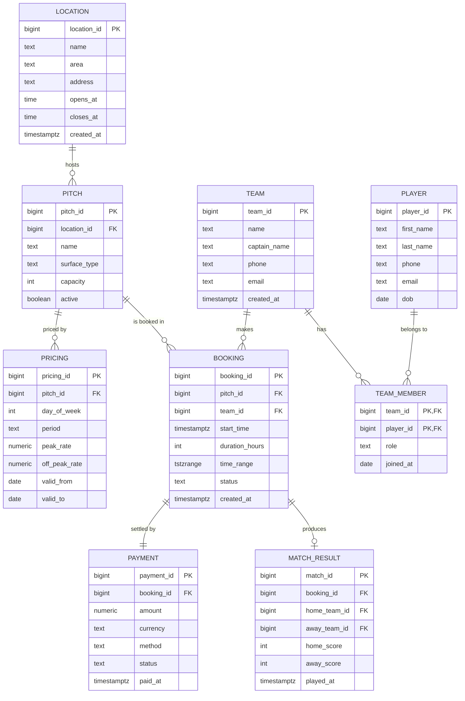

# ER Diagram — KickOff Arena (5-a-side pitch booking)

Mermaid renders this diagram natively on GitHub. Open this file on the GitHub
web UI to see it.

## Cardinality notes

- A `LOCATION` has many `PITCH`es; a `PITCH` belongs to exactly one location.
- A `PITCH` has many `PRICING` rows (one per day-of-week × period).
- A `TEAM` ↔ `PLAYER` is many-to-many through `TEAM_MEMBER`.
- A `BOOKING` is for exactly one `PITCH` made by exactly one `TEAM`.
- A `BOOKING` has exactly one `PAYMENT` (a deposit at booking time; refunds
  update the same row).
- A `BOOKING` may produce at most one `MATCH_RESULT` (the match is played after
  the booking; some bookings end in a no-show, in which case there is no row).

## How the exclusion constraint fits

The `BOOKING` table stores both `start_time` and a derived `time_range
tstzrange`. The exclusion constraint `EXCLUDE USING gist (pitch_id WITH =,
time_range WITH &&)` is what actually enforces "no overlapping bookings on the
same pitch". The `start_time`, `duration_hours` columns are kept for
readability and for the CHECK constraints.
