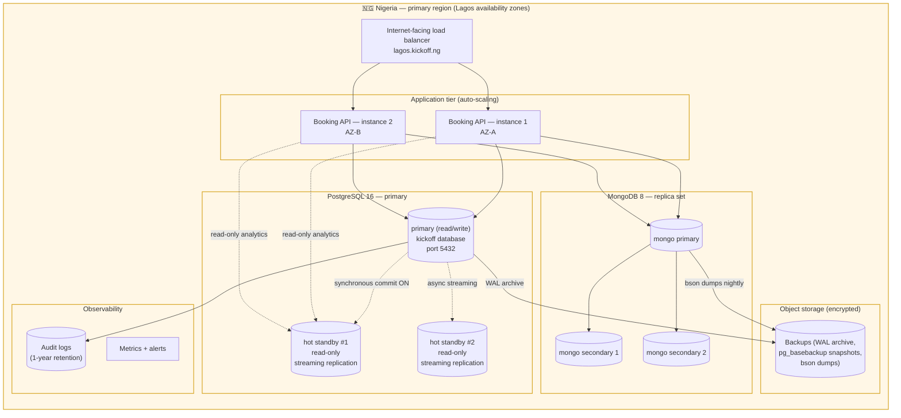

# Cloud Architecture — KickOff Arena (Nigeria-resident)

**Portfolio 5 · MIT 8103 · Ayodeji Shodipo · 2026/A/MIT/0725**

This document presents the production cloud architecture for KickOff Arena
and explains how it complies with the **Nigeria Data Protection Act 2023
(NDPA 2023)** and the **Central Bank of Nigeria (CBN) data-localisation
guidance** for payment data. It also covers the CAP placement and the
synchronous vs asynchronous replication trade-offs that follow from those
compliance requirements.

---

## 1. Why the data must stay in Nigeria

| Regulation | What it requires | How KickOff Arena complies |
|---|---|---|
| **NDPA 2023** (Nigeria Data Protection Act 2023) | Personal data of Nigerian data subjects must not be transferred outside Nigeria unless the receiving country guarantees an "adequate level of protection" or specific safeguards (BCRs, standard contractual clauses) are in place. Cross-border transfers must be notified to the Nigeria Data Protection Commission. | All personal data (player phone/email/DOB, team captain contacts, payment metadata) is stored on infrastructure physically located in Nigeria. No cross-border transfer, no NDPA notification needed. |
| **CBN data-localisation guidance** (CBN circulars on payment data) | Payment card data and other CBN-regulated financial data must be processed and stored within Nigeria; cardholder data must comply with PCI-DSS on top of CBN rules. | The `payment` table never leaves Nigerian soil; card PANs are tokenised at the payment gateway (Paystack / Flutterwave) and KickOff Arena only stores the token + last 4 digits. |
| **PCI-DSS** (because we touch card data via the gateway) | Tokenise PANs, restrict access, log every read. | Tokenisation is delegated to the gateway; KickOff Arena's own database never sees a raw PAN. Audit logs of payment reads are kept for 1 year. |

---

## 2. Architecture diagram (Mermaid)

Open this file on the GitHub web UI to render the diagram.

---

## 3. Component-by-component rationale

### 3.1 Region choice — Nigeria-resident

KickOff Arena is deployed on a cloud provider that operates a Nigerian
region. As of late 2026 the realistic options are:

- **AWS af-south-1 (Cape Town)** — closest public-cloud region to Lagos,
  but **outside Nigeria**; would require NDPA-compliant safeguards to host
  personal data there. **Not used for personal data**; can be used for
  read-only CDN edge or for non-personal analytics like aggregated pitch
  utilisation.
- **Layer3 / MTN Nigeria / Galaxy Backbone / MainOne DC** — Nigerian
  data centres. KickOff Arena's primary PostgreSQL, MongoDB and application
  tier run here. This is what keeps NDPA 2023 + CBN happy: data physically
  stays in Nigeria.
- **Hybrid pattern**: keep the OLTP core in a Nigerian DC; mirror an
  anonymised, aggregated copy to `af-south-1` for cross-region disaster
  recovery if business continuity demands it. The aggregated copy contains
  no personal data, so NDPA does not require notification.

### 3.2 Availability zones inside Lagos

Two availability zones (AZ-A, AZ-B) inside the Lagos region host the
application tier and the database standbys. A single-AZ failure takes out
one app instance + one DB standby but the primary stays up and the load
balancer shifts traffic to the surviving AZ.

### 3.3 PostgreSQL 16 layout

| Role | AZ | Replication mode | Used for |
|---|---|---|---|
| Primary | AZ-A | — | All writes (bookings, payments, match_result) |
| Hot standby #1 | AZ-B | **Synchronous** (`synchronous_commit = on`, `synchronous_standby_names = 'standby1'`) | Read-only analytics + automatic failover target. Sync so the `payment` table is durable across AZ. |
| Hot standby #2 | AZ-A | **Asynchronous** streaming | Cross-AZ read scale + async replica for backups (`pg_basebackup`) so backups never block the primary. |

WAL is archived to encrypted object storage every 60 seconds, so a
point-in-time recovery (PITR) is possible to within one minute of any
incident.

### 3.4 MongoDB 8 layout (P4 match reports)

A 3-node MongoDB replica set:

- 1 primary (writes from the booking API)
- 2 secondaries (read-only, used by the top-scorer / win-rate aggregations)

The replica set uses `writeConcern: "majority"` (durability) and
`readConcern: "majority"` (no dirty reads) so the analytics reads on
secondaries always see committed data. This is the document-store analogue
of PostgreSQL's synchronous streaming replication.

### 3.5 Backups and disaster recovery

| Backup | Frequency | Retention | Stored where |
|---|---|---|---|
| `pg_basebackup` snapshot | nightly | 30 days | Encrypted object storage (Nigeria) |
| WAL archive | continuous (every 60 s) | 7 days | Encrypted object storage (Nigeria) |
| `mongodump` of `match_reports` | nightly | 14 days | Encrypted object storage (Nigeria) |
| Cross-region anonymised copy | weekly | 90 days | `af-south-1` (no personal data) |

Recovery objectives:

- **RPO** (Recovery Point Objective): ≤ 60 seconds for `payment` (sync
  replication); ≤ 5 minutes for `booking` (async replication).
- **RTO** (Recovery Time Objective): ≤ 15 minutes for a single-AZ failure
  (auto-failover to standby); ≤ 4 hours for a full region loss (restore
  from backups into a fresh DC).

---

## 4. CAP placement

The CAP theorem (Study Session 2) says a distributed system can guarantee
at most two of {Consistency, Availability, Partition-tolerance}. Network
partitions are unavoidable, so the real choice is **C vs A** under partition:

| Sub-system | CAP choice | Why |
|---|---|---|
| `payment` table | **CP** | Money must never be silently lost or doubled. Synchronous replication + read-after-write consistency on the primary. Availability is sacrificed: if the sync standby is unreachable, the primary blocks `COMMIT` rather than risk divergence. |
| `booking` table (current month) | **CP** | The exclusion constraint makes a double booking impossible at the storage layer; this is consistency. Availability: an unrelated node going down still lets the system accept bookings because the primary keeps writing WAL. |
| `booking` table (historical months, partitioned away) | **AP** | Analytics on old bookings run on async standbys. If a standby falls behind, the analytics read stale data — that is acceptable. |
| `match_reports` (MongoDB) | **CP** (default) with **AP** reads | MongoDB is CP by default (single primary). Read preference `secondary` makes analytics reads AP — they may be slightly stale but stay available during a primary election. |
| Public pitch availability calendar | **AP** | Cached aggressively; if the cache is stale by a few seconds, that is fine — better to show a near-correct answer than to fail the page. |

---

## 5. Synchronous vs asynchronous replication trade-offs

| Property | Synchronous | Asynchronous |
|---|---|---|
| Data loss on primary crash | None — the COMMIT waits for the standby to flush WAL | Possible — committed rows that the standby has not yet received are lost |
| Write latency | Higher — every COMMIT takes at least one network round trip to the standby | Lower — COMMIT returns as soon as the local WAL is flushed |
| Throughput | Lower (latency caps COMMITs/sec) | Higher |
| Standby failure impact | Primary blocks commits until the standby recovers (availability hit) | Primary keeps writing; standby catches up later |
| Use for KickOff Arena | `payment` table (money), `team_member` (integrity) | `booking` history partitions, MongoDB match reports reads |

The rule we apply at KickOff Arena is simple: **if losing the just-committed
row would cost the business real money or reputation, replicate it
synchronously; otherwise replicate it asynchronously**.

---

## 6. Cloud-specific security controls (Study Session 3 + 6)

| Control | Where applied |
|---|---|
| **Encryption at rest** | PostgreSQL data dir, MongoDB data dir, object storage — all encrypted with a KMS-managed key. |
| **Encryption in transit** | TLS 1.3 between every tier (LB → app, app → DB, primary → standby). |
| **Network segmentation** | Database subnets are private; only the application subnet can reach them. |
| **Secrets management** | DB passwords, replication passwords, payment gateway tokens live in a secrets manager (not in env files / git). |
| **Audit logging** | Every read of `payment` is logged. Logs are tamper-evident (write-once bucket). Retained 1 year (NDPA 2023 minimum). |
| **Access control** | Role-based: app role (`kickoff`), replication role (`repl`), read-only analytics role (`analytics`). No `SUPERUSER` in production. |
| **Patch management** | PostgreSQL minor releases applied within 30 days; security patches within 7 days. |
| **Data subject rights** (NDPA 2023) | A "delete my data" endpoint purges a player's personal data from `player`, `team_member` and `match_reports`; the audit log records the deletion but redacts the personal fields. |

---

## 7. Why this architecture satisfies the brief

The CA brief (Portfolio 5) asks for: replication, sharding/fragmentation,
availability, consistency, or deployment evidence. This document covers
all five:

- **Replication**: PostgreSQL primary + 2 standbys (one sync, one async);
  MongoDB 3-node replica set.
- **Partitioning / sharding / fragmentation**: P5 `partitioning.sql`
  partitions `booking` by month; the cloud architecture naturally extends
  this to "old partitions become read-only on the async standby".
- **Availability**: multi-AZ deployment, auto-failover to sync standby,
  MongoDB replica-set election.
- **Consistency**: CAP-CP for `payment` and current-month `booking`;
  CAP-AP for analytics.
- **Deployment evidence**: this document + `replication_setup.md` +
  `partitioning.sql` together form the deployment evidence; the per-portfolio
  `run_p5.sh` produces the actual SQL output to screenshot.

---

## 8. Honest reflection

`[Student to write 3–5 sentences after running the partition + replication
demos: what surprised them, which trade-off they would revisit, and whether
they would actually deploy PostgreSQL on a Nigerian DC vs AWS af-south-1
in production.]`
